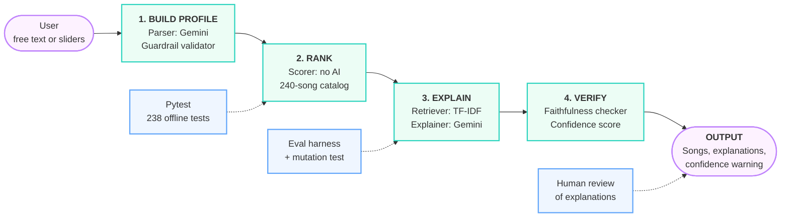

# 🎵 Music Recommender: an Applied AI System

Describe what you want to hear in plain English, and get five songs from a 240-song catalog, each with a short reason, a confidence level, and checks that catch the AI when it gets something wrong.

**Original project:** *Music Recommender Simulation* (CodePath AI110, Module 3). It was a command-line, content-based recommender. A user gave a favorite genre, a favorite mood, and target energy, positivity and acousticness. It scored 20 songs and returned the top 5, with a reason for each score such as "mood match (+0.25)". Its own evaluation exposed the limits this project addresses: a tiny catalog, brittle exact-match labels, and no input validation.

## What this version adds

| Rubric feature | What it does here |
|---|---|
| **RAG** | TF-IDF retrieval over 38 hand-checked knowledge notes (genres, subgenres, moods, feature definitions). Gemini writes each song's explanation using only the retrieved notes and the score breakdown. |
| **Reliability and testing** | A rule-based faithfulness checker on every AI explanation, an inspectable confidence score, a run log, 238 offline tests, and an evaluation harness with saved before/after reports. |
| **Guardrails** | One validator for every input path. The model never chooses the mood. Untrusted text stays apart from the system prompt. Every AI step has a non-AI fallback. |

Also new: a Streamlit UI, a 240-song catalog built from public data, and Gemini free-tier integration.

**Why it matters.** An AI that explains its picks is only useful if the explanations are true. Here the AI never ranks songs (plain arithmetic does), and every sentence it writes is checked against the evidence before you see it. The project is as much about measuring where that breaks as about the recommender itself. Read [model_card.md](model_card.md) for the limits.

---

## Architecture overview



Data flows left to right. A request goes in as free text or slider settings. The **parser** (Gemini) turns text into a genre (or none) plus three numbers, and the mood is computed from those numbers, never taken from the model. The **guardrail** validates the profile. The **scorer** ranks the catalog with plain weighted arithmetic. The **retriever** pulls notes for each result song, and the **explainer** (Gemini) writes a reason per song from those notes. The **faithfulness checker** verifies each reason and swaps in a plain sentence if it fails. A **confidence score** summarizes how far to trust the list, and the UI shows it all and logs the run.

Pytest, the evaluation harness and a human reviewer check the AI from outside the pipeline. The step-by-step flow with every fallback, and the testing and review loop, are in [diagrams/system_diagram.md](diagrams/system_diagram.md).

| File | Role |
|---|---|
| [app.py](app.py) | Streamlit UI |
| [src/profile.py](src/profile.py) | `UserProfile`, label normalization, the validator |
| [src/recommender.py](src/recommender.py) | Weighted scorer and top-k ranking |
| [src/catalog.py](src/catalog.py), [scripts/build_catalog.py](scripts/build_catalog.py) | Build `data/songs.csv`, including the derived-mood rule |
| [src/llm_parser.py](src/llm_parser.py) | Free text to profile through Gemini |
| [src/retriever.py](src/retriever.py), [data/knowledge/notes.json](data/knowledge/notes.json) | TF-IDF retrieval over 38 notes |
| [src/explainer.py](src/explainer.py) | One batched Gemini call per result list, with a fallback |
| [src/reliability.py](src/reliability.py) | Faithfulness checker and confidence score |
| [src/runlog.py](src/runlog.py) | JSONL run log (`logs/`, gitignored) |
| [eval/](eval/) | Profiles, metrics, `run_eval.py`; saved reports in `eval/results/` |
| [tests/](tests/) | 238 offline tests |

**Scoring.** Each feature gets a closeness score, then a weighted sum: energy 0.30, mood 0.25, valence 0.20, genre 0.15, acousticness 0.10. Numeric features use `1 - abs(song - target)`; mood and genre score 1 for a match, else 0. If the user has no genre preference, genre is skipped and the other weights are rescaled to sum to 1.

---

## Sample interactions

Three requests run end to end against the live API on 2026-11-15 with `gemini-3.5-flash-lite`, pasted exactly as they were printed. Each block shows the parsed profile, the confidence report, and the top 3 of 5 with the score breakdown and the AI explanation. `llm:` marks an explanation written by Gemini that passed the faithfulness check; `problems: []` means the checker found nothing wrong. Model output varies between runs.

These came from calling the app's own functions in sequence (`parse_request` into `recommend_songs` into `explain_recommendations` into `assess_confidence`), the same path `app.py` uses. The longer log, including the offline commands, is in [docs/execution_evidence.txt](docs/execution_evidence.txt).

### 1. Free text with a named genre

Input: `upbeat pop for a morning run`

```
REQUEST: upbeat pop for a morning run
source: text | profile: {'favorite_genre': 'pop', 'favorite_mood': 'happy', 'target_energy': 0.85, 'target_valence': 0.9, 'target_acousticness': 0.1}
confidence: high (0.99) []
#1 Up & Down - Vengaboys [pop/dance pop/happy] score 0.97
    breakdown: energy close (+0.28), mood match (+0.25), valence close (+0.20), genre match (+0.15), acousticness close (+0.09)
    llm: This dance pop track is built for the dance floor with upbeat tempos, bright synths, and strong, repetitive hooks, fitting your happy mood. | problems: [] | error: None
#2 It's On - From "Camp Rock 2: The Final Jam" - Demi Lovato [pop/post-teen pop/happy] score 0.96
    breakdown: energy close (+0.27), mood match (+0.25), valence close (+0.20), genre match (+0.15), acousticness close (+0.09)
    llm: This pop song matches your happy mood with its upbeat, bright, and lively feel, featuring catchy melodies, clear hooks, and polished production. | problems: [] | error: None
#3 Acordeão - Tiësto [pop/dance pop/happy] score 0.96
    breakdown: energy close (+0.29), mood match (+0.25), valence close (+0.18), genre match (+0.15), acousticness close (+0.09)
    llm: As a dance pop track, it brings a happy mood with upbeat tempos, bright synths, and strong, repetitive hooks designed for the dance floor. | problems: [] | error: None
```

The parser picks up both the genre and the intent: pop, happy, energy 0.85. All five features match or come close, so the scores sit at 0.96 and above.

### 2. Free text with no genre named

Input: `something to help me focus while studying`

```
REQUEST: something to help me focus while studying
source: text | profile: {'favorite_genre': None, 'favorite_mood': 'chill', 'target_energy': 0.3, 'target_valence': 0.5, 'target_acousticness': 0.8}
confidence: high (0.99) []
#1 Sidelove - Astrid S [pop/post-teen pop/chill] score 0.98
    breakdown: energy close (+0.34), mood match (+0.29), valence close (+0.23), acousticness close (+0.12)
    llm: This post-teen pop track fits your chill mood preference with its relaxed, easygoing, and pleasant tone. | problems: [] | error: None
#2 Love Yourself - Justin Bieber [r&b/hip pop/chill] score 0.96
    breakdown: energy close (+0.33), mood match (+0.29), valence close (+0.23), acousticness close (+0.11)
    llm: Selected for your chill mood, this hip pop song delivers a relaxed, easygoing, and pleasant listening experience. | problems: [] | error: None
#3 Red Virgin Soil - Agnes Obel [pop/indie poptimism/chill] score 0.93
    breakdown: energy close (+0.35), mood match (+0.29), valence far (+0.17), acousticness close (+0.11)
    llm: This indie poptimism track matches your chill mood, offering a relaxed, easygoing, and pleasant vibe. | problems: [] | error: None
```

`favorite_genre: None` is the point here. The parser does not invent a genre, so the genre feature is skipped and the other weights are rescaled, which is why the breakdown shows four terms instead of five and they add up differently. The results span pop and r&b. The explanations are accurate but generic.

### 3. Off-topic input falls back safely

Input: `what is the weather in Lagos tomorrow`

```
REQUEST: what is the weather in Lagos tomorrow
PARSE FAILED -> I couldn't find a music preference in that request.
source: sliders_fallback | profile: {'favorite_genre': None, 'favorite_mood': 'chill', 'target_energy': 0.5, 'target_valence': 0.5, 'target_acousticness': 0.5}
confidence: high (0.99) []
#1 Uncle Albert / Admiral Halsey - Medley / Remastered 2012 - Paul McCartney [rock/permanent wave/chill] score 0.98
    breakdown: energy close (+0.35), mood match (+0.29), valence close (+0.23), acousticness close (+0.11)
#2 Lost in Someone Else - Casey Derhak [pop/dance pop/chill] score 0.97
    breakdown: energy close (+0.33), mood match (+0.29), valence close (+0.23), acousticness close (+0.11)
#3 Old School Heart - Arjuna Oakes [r&b/neo soul/chill] score 0.96
    breakdown: energy close (+0.32), mood match (+0.29), valence close (+0.23), acousticness close (+0.11)
```

The parser refuses the request rather than guessing, and the app falls back to the sidebar sliders (`source: sliders_fallback`, here the defaults: no genre, mood chill, all targets 0.5).

**A limit this run shows:** confidence still reads `high (0.99)` even though the request was never understood. Confidence describes how well the *slider profile* fits the catalog, not whether the original request made sense. The parse failure is shown to the user as a separate message.

---

## Design decisions and trade-offs

- **The AI never ranks songs.** Ranking is plain weighted arithmetic, so it is repeatable, testable and explainable. Gemini only turns text into numbers and writes explanations. *Trade-off:* the system can't use language understanding to rank, so it can't handle requests the numbers can't express.
- **Mood is computed from energy and valence, not asked from the model.** Early on the model sometimes chose a mood that disagreed with its own numbers (agreement was 0.77). Computing the mood removed that. *Trade-off:* moods are a heuristic, and "chill" just means calm and positive. The 1.0 agreement that results is true by construction and is not a model improvement.
- **Genre is optional.** The parser returned a genre even when the user named none (100% of the 5 test phrasings), so it now returns null unless a genre is named or clearly implied, and the scorer skips genre and rescales the weights. *Trade-off:* results for no-genre requests span genres.
- **Three-tier grading of the parser.** The first evaluation graded any guessed genre as wrong. Marking a guess as flatly wrong turned out to be subjective, since some guesses are defensible (an "acceptable" call), so grading was changed mid-project to three tiers: **ideal** (no genre), **acceptable** (a defensible guess), **wrong**. *Trade-off:* the change makes the "before" number look better (0.923 tiered vs 0.615 strict), so both are reported.
- **TF-IDF retrieval, not embeddings.** The knowledge base is 38 short notes, so keyword matching is enough, needs no extra API, and is easy to inspect. Plain TF-IDF mis-retrieved nested labels ("electro house" inside "progressive electro house"), so lookups are scoped by note kind with an exact-name bonus. *Trade-off:* it can't match synonyms.
- **A rule-based checker, not an LLM judge.** The faithfulness checker is deterministic and free, with no second model to trust. *Trade-off:* it is a heuristic. It once rejected "close acoustic feel", echoing the breakdown phrase "acousticness close", because it can't tell "close to your target" from "is acoustic".
- **Fallbacks everywhere.** No key, an API error, a 429, or a failed check never breaks the app; it degrades to sliders or a plain sentence. *Trade-off:* the fallback sentences are plainer.

---

## Testing summary

Full detail and caveats are in [model_card.md](model_card.md). Reports are in `eval/results/`.

**What worked**

- **Guardrail:** 100% of the malformed profiles I wrote were rejected and 100% of valid ones accepted.
- **No-genre parsing (5 phrasings x 3 runs):** genre invented went from 100% to 0%, and the tiers from 0 ideal / 4 acceptable / 1 wrong to 5 / 0 / 0 in every run. Named-genre accuracy and mood accuracy stayed at 100%.
- **Faithfulness checker:** caught 100% of deliberately corrupted explanations with 0 false alarms on untouched ones.
- **Confidence:** coherent requests score about 0.97 to 0.99; conflicting, unknown-label or weak requests score low.

**What didn't, or what the numbers don't show**

- Only 5 no-genre phrasings were tested. That does not show the model never invents a genre.
- The checker's corrupted-explanation test uses blunt mutations, and some rules were tuned after seeing misses, so 100% is optimistic. On real explanations it raised 2 false alarms in 215 across four runs.
- The confidence expectations were written after I saw the scores, and the score can't tell a plausible-looking wrong result from a right one.
- The ranking sweep (90 profiles, top 5) found 28% of the catalog (67 of 240 songs) is never recommended, and the catalog is skewed toward "happy" and "intense" moods.
- Parsed numbers drift between runs (energy 0.2 vs 0.3). They stayed within the 0.1 tolerance every time.
- Free-tier 429 errors contaminated two earlier runs until API errors were counted separately.

**What I learned.** Several metrics looked good for the wrong reasons (mood agreement became 1.0 by construction), and a test I wrote myself will pass more easily than one I didn't. Single live runs are noisy, so I average several before comparing.

---

## Setup

Tested on **Python 3.13**. Run commands from this folder.

```bash
python3 -m venv .venv
source .venv/bin/activate          # Windows: .venv\Scripts\activate
pip install -r requirements.txt
```

**Gemini key (optional).** Without a key, sliders, scoring and fallback explanations still work. The key is only needed for free-text requests and AI explanations.

```bash
cp .env.example .env
# edit .env and set GEMINI_API_KEY=<your key>   (never commit .env)
```

Get a free key from Google AI Studio. To use a different model, set `GEMINI_MODEL` in `.env` (default `gemini-3.5-flash-lite`).

**Catalog.** `data/songs.csv` (240 songs) is committed, so you can skip this. To rebuild it from the source:

```bash
curl -L -o data/spotify_songs.csv \
  https://raw.githubusercontent.com/rfordatascience/tidytuesday/master/data/2020/2020-01-21/spotify_songs.csv
python -m scripts.build_catalog
```

The build samples 10 songs from each of 24 subgenres with a fixed seed, so it should reproduce the same catalog.

**Run the app**

```bash
streamlit run app.py
```

**Run the tests** (238, all offline; real Gemini calls are blocked)

```bash
python -m pytest -q
```

**Run the evaluation**

```bash
python -m eval.run_eval --name my_run --no-llm     # offline checks only
python -m eval.run_eval --name my_run --delay 6    # adds live Gemini checks (takes several minutes)
```

Keep `--delay` at 6 or more to avoid free-tier 429 errors, and average several live runs before comparing. A quick developer check of the fixed profiles: `python -m src.main`.

---

## Execution evidence

Captured terminal output from the commands above is in **[docs/execution_evidence.txt](docs/execution_evidence.txt)**, so the system can be checked without running it or watching a demo. It contains four blocks:

| Block | Command | What it evidences |
|---|---|---|
| 1 | `python -m pytest -q` | 238 offline tests pass with no network |
| 2 | `python -m src.main` | A full top-5 with score breakdowns, and all 7 malformed profiles rejected by the guardrail with their reasons |
| 3 | `python -m eval.run_eval --name evidence --no-llm` | Guardrail catch rate, the 90-profile ranking sweep, and confidence against expectations |
| 4 | Three live free-text requests | The parser, RAG explanations and confidence end to end, including the off-topic fallback |

Blocks 1 to 3 are offline and should reproduce exactly. Block 4 calls the live API, so its wording varies between runs. The JSON report from block 3 is saved as [eval/results/evidence.json](eval/results/evidence.json).

Guardrail output from block 2, abridged:

```
>>> Profile: out_of_range
    Rejected by guardrail: target_energy must be between 0 and 1, got 3.0

>>> Profile: missing_key
    Rejected by guardrail: missing fields: target_valence, target_acousticness

>>> Profile: string_number
    Rejected by guardrail: target_energy must be a number, got str
```

---

## Data

The catalog is sampled from the **"30000 Spotify Songs"** dataset, distributed through [TidyTuesday, 2020-01-21](https://github.com/rfordatascience/tidytuesday/tree/master/data/2020/2020-01-21). The audio features come from the Spotify Web API (collected with the `spotifyr` R package), and genres come from the playlists the songs appeared in, not from a per-song label. . This project uses a 240-song sample for classroom and demo purposes only, and the raw file is not committed.

---

## Reflection

Building the checks taught me more than building the recommender. The AI parts were easy to get working and hard to trust, so most of the effort went into measuring them and into being honest about which results were real. My graded responsible-AI reflection (how I worked with AI, a suggestion I accepted and one I rejected, and the system's limitations) is in [model_card.md](model_card.md).
