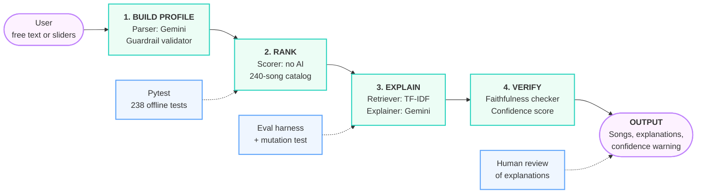
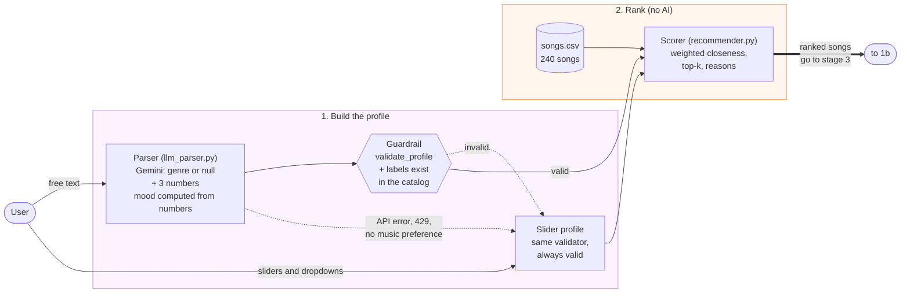
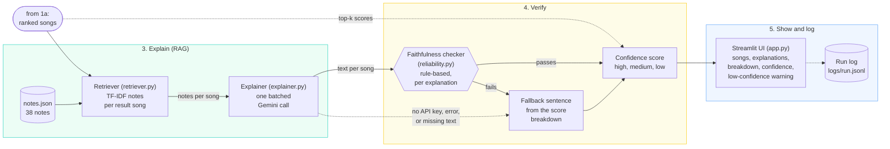
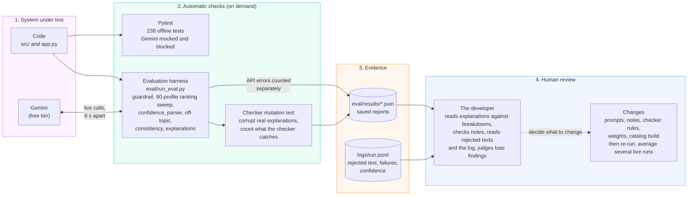

# System Diagram

Derived from the code in `app.py` and `src/`. The first diagram is the short overview: the main components, how data flows from input to output, and where tests and people check the AI. The two after it are detail views of the same system.

## Overview

- **Components (left to right, as data flows):** the parser (Gemini) turns text into a profile, the guardrail validates it, the scorer ranks the songs, the retriever finds notes for each result, the explainer (Gemini) writes the reasons, the faithfulness checker verifies them, and the confidence score summarizes how far to trust the result.
- **Data flow:** a request or slider settings go in, a ranked list with explanations and a confidence level comes out. Gemini never ranks songs.
- **Where the AI is checked:** the guardrail and the faithfulness checker run on every request; pytest and the eval harness run on demand; a person reviews explanations, notes and the run log.

## Detail 1: Request flow (input, process, output)

Stages 1 and 2 first, then stages 3 to 5.

**1a. Build the profile and rank**

**1b. Explain, verify, show**

**Reading the diagram**

- **The five groups are the stages.** Group 1 has two ways in and one guardrail. Text goes through Gemini first; sliders skip the model. Both end in `validate_profile`.
- **Gemini never ranks songs.** It only turns text into a profile (stage 1) and writes explanation text (stage 3). Ranking is plain arithmetic.
- **Every AI step has a non-AI fallback.** A failed parse uses the sliders. A failed or missing explanation uses a sentence built from the score breakdown.
- **Order matters.** Retrieval runs after scoring and looks up each result song's own labels, not the user's words. Confidence is computed last, so it can include how many explanations passed the check.
- **Without an API key** the app still runs: sliders, scoring, fallback explanations and confidence all work.

## Detail 2: Testing and human review

**Reading the diagram**

- **Pytest** checks the deterministic code and the AI wrappers without any network. It cannot say how Gemini really behaves.
- **The evaluation harness** calls live Gemini and writes a JSON report, so a before and after can be compared. One live run is noisy, so several are averaged.
- **The mutation test** checks the checker: it corrupts real explanations on purpose and counts what is caught, and counts false alarms on untouched ones.
- **Humans stay in the loop.** Only a person can judge whether an explanation is good, rather than merely consistent with the evidence. People also decide what to change.

## Where the AI is checked

| # | Check | Type | When |
|---|---|---|---|
| 1 | Guardrail (`validate_profile`, plus catalog-label check for parsed text) | Automatic | Every request |
| 2 | Faithfulness checker | Automatic | Every AI explanation |
| 3 | Confidence score and low-confidence warning | Automatic, shown to the user | Every request |
| 4 | Pytest suite | Automatic, offline | On demand |
| 5 | Evaluation harness and mutation test | Scripted, live Gemini | On demand |
| 6 | Human spot-check of explanations, notes and the run log | Manual | By the developer |

## What the checks cannot do

- The faithfulness checker is a heuristic. It raised false alarms on natural phrasing such as "close acoustic feel".
- The confidence score cannot tell a plausible-looking wrong result from a right one.
- Neither automatic check can judge whether an explanation is good writing, only whether it contradicts the evidence.
